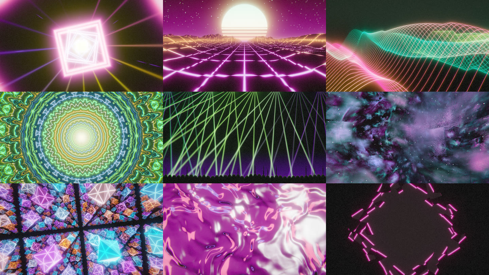
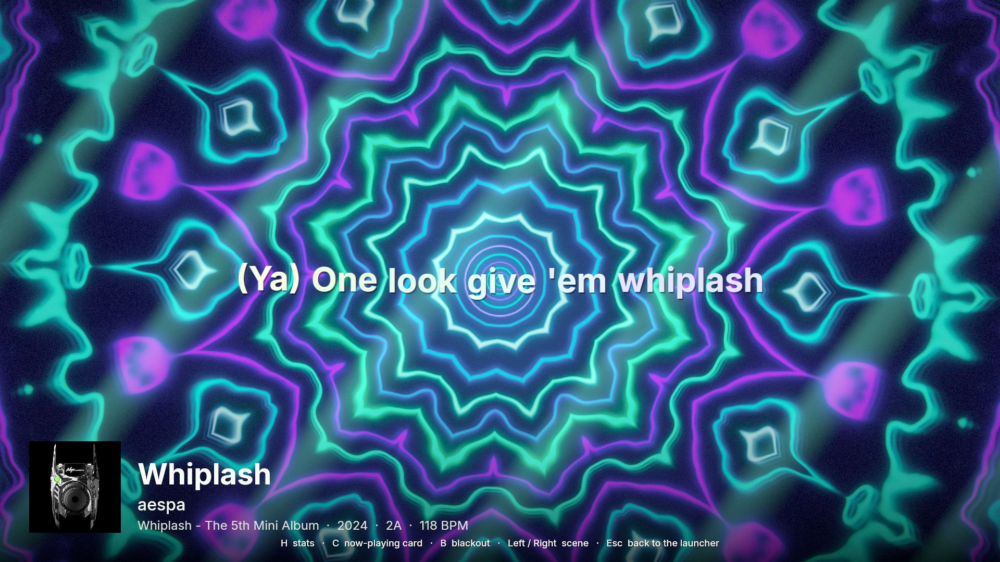
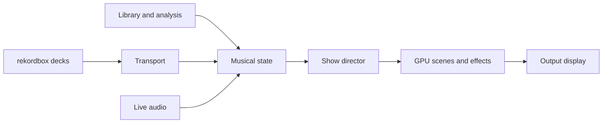

<p align="center">
  
</p>

<h1 align="center">OnSet: live visuals for rekordbox</h1>

<p align="center">Your tracks set the colour. Your mix drives the motion.</p>

<p align="center">
  <a href="#get-started">Get started</a> ·
  <a href="#scenes">Explore the scenes</a> ·
  <a href="#make-it-your-show">Controls and customisation</a> ·
  <a href="#development">For developers</a>
</p>

<p align="center">
  <a href="https://github.com/matias-io/OnSet/actions/workflows/ci.yml"></a>
  <a href="LICENSE"></a>
  
</p>

OnSet turns your rekordbox set into a visual show on a second screen. It follows the
playing track, picks colours from its artwork and moves with the mix. Beat grids,
phrases and hot cues let the visuals build toward a drop before it lands.

Choose a screen, pick Chill, Club or Festival, and press **Start show**. Let Auto choose
the scenes, or take control while you play.



**Pre-alpha.** Previously tested with rekordbox 7.2.18 and 7.2.19 on Windows 11, an
RTX 3050 Ti and a DDJ-FLX10. Other rekordbox versions need local calibration. Test your
setup before using OnSet at a show.

## What you can do

- Run ten main scenes and four lighter classics, with automatic scene selection and
  transitions based on the track's tempo, key, genre, mood and artwork.
- Watch bass, mids, treble and drum hits drive different parts of the picture. Bloom,
  light trails and effects respond to phrases, drops and hot cues.
- Show track details and artwork in a now-playing card. Add synced lyrics in Clean,
  Glow or Karaoke style when lyrics are available.
- Choose your output display, audio input, quality and effects on the app's **Show** page.
  Add your own blackout logo or edit the scene shaders.
- Prepare before the show: analyse tracks, review and approve cues, compare
  transitions and plan sets, then write approved cues to rekordbox after an exact
  preview and backup. See [preparing a set](docs/PREPARATION.md).

OnSet runs on the same Windows laptop as rekordbox. It listens to the controller's
recording input, with Windows output capture as a fallback. rekordbox plays the music;
OnSet supplies the visuals.

## Get started

### Check your setup

| You need | Details |
| --- | --- |
| Windows | Windows 11, 64-bit |
| rekordbox | rekordbox 7 in Performance mode; shipped calibration for 7.2.18 and 7.2.19 |
| Graphics | A GPU with Vulkan or DirectX 12 support |
| Display | A second screen is recommended; windowed output works on one screen |
| Controller | Optional; choose its recording input when using one |

### Get OnSet

There is no published Windows download yet. Build the current pre-alpha from source
with Rust via rustup and Visual Studio Build Tools with the C++ workload. The pinned
toolchain in `rust-toolchain.toml` selects the Rust version.

```powershell
git clone https://github.com/matias-io/OnSet.git
cd OnSet
cargo build --locked --release -p onset-visuals -p onset-cli
.\target\release\onset.exe
```

That builds the show on its own. The full OnSet app, with preparation, the live view and
the Show page, is `onset-desktop`; [docs/DESKTOP.md](docs/DESKTOP.md) explains how to
build it.

To make a portable Windows zip you can move to another machine:

```powershell
.\scripts\package.ps1
```

The archive in `dist/` includes both executables, calibrated offsets, editable shaders,
this README and license notices. Unzip the whole folder and open `onset.exe`.
Fonts and default shaders are also embedded in the app.

### Start your first show

1. Start rekordbox in Performance mode and load a track.
2. Open OnSet and go to **Show**. Choose the output screen and a style.
3. Check **Output and audio** if you need to choose the controller's recording input or a
   Windows output. It shows the device in use while a show runs.
4. Press **Start show** (also in the OnSet Live window) and play the track. Finding the
   decks can take about 20 seconds. Settings you change while the show runs apply at once.
5. For another rekordbox version, open **Settings → rekordbox link** and follow the
   calibration prompts: leave a loaded track paused, then play, pause and play it when
   asked. This takes about two minutes, once per version.

The show runs in its own window of the app. On one display, untick **Fullscreen** to
preview it in a window. **Esc** on the show, or **End show** in the app, ends it.
Use a release build for a show. Debug builds compile faster but render much slower.

`onset.exe` still opens the show on its own, straight to the configured screen, for
development and the frame bench (`--bench`).

## Scenes

Auto chooses a scene to suit the music and can change it between tracks, at drops or
after a few phrases. Turn Auto off to keep a favourite scene. Each scene has speed,
audio response and colour controls on the Show page's **Scenes** tab.

| Scene | What you see |
| --- | --- |
| Neon Tunnel | Glowing diamond frames, twisting with the mids and accelerating with the bass |
| Outrun | A retro sun, neon grid and mountains shaped by the recent spectrum |
| Silk | Waves of light that ripple on each kick |
| Mandala | A kaleidoscope whose segments multiply at the drop |
| Laser Show | Beams sweeping through haze, with fans opening at the drop |
| Deep Space | A slow flight through a nebula that breathes with the bass |
| Zero Gravity | Drifting debris that gathers during a build and scatters at the drop |
| Crystal | A neon crystal lattice lit by different frequency bands |
| Liquid | Flowing chrome, moving with the bass and shimmering with the highs |
| Cover Art | The track's artwork mirrored, warped and broken apart at the drop |

The classic Pulse, Ring, Warp and Cells scenes offer lighter alternatives. Low and
Medium quality also keep the heaviest scenes out of Auto. Adaptive resolution reduces
the rendering size when the GPU falls behind and restores it when frames are smooth.

## Make it your show

The app's **Show** page holds the essentials for a set on its first tab. The other
tabs let you adjust the details without hunting through configuration files.

| Tab | What you can change |
| --- | --- |
| Show | Output screen, fullscreen, Chill / Club / Festival style, Auto scenes, overlays and quality; while a show runs, buttons that try a build-up, drop, phrase, breakdown or track change without music |
| Effects | Effect strengths |
| Scenes | Auto rotation, and speed, audio response and colour per scene |
| On screen | Now-playing card and stats placement, size and fields, and a custom blackout logo |
| Lyrics | Enable lyrics, choose a style, control online lookup and look up the library |
| Output and audio | Graphics adapter, frame timing, render scale, and the recording input or loopback output |

rekordbox calibration is under **Settings → rekordbox link**.

Synced lyrics follow the playhead line by line. OnSet looks them up on LRCLIB, uses
MusicBrainz for ISRC matching when needed, and caches the results. Availability depends
on the track and version of the recording. You can look up your library ahead of a set
or turn off online lookup and use cached lyrics only.

The bundled fonts do not cover every script. Korean lyrics currently show missing
characters.



Clean lyrics and artwork over Mandala, captured from rekordbox 7.2.19 with no
controller attached. Music, artwork and the short lyric excerpt belong to their
respective rights holders.

On the show window during a show (click it first), even if the app is busy:

| Key | Action |
| --- | --- |
| H / C | Toggle stats / now-playing card |
| Left / Right | Previous / next scene |
| B | Toggle blackout |
| F | Toggle fullscreen |
| Esc | End the show |

## If something is not following the music

| Symptom | What to check |
| --- | --- |
| Waiting for rekordbox | Open Performance mode, load a track and allow about 20 seconds for deck discovery |
| Version is not calibrated | Run the calibration in **Settings → rekordbox link** with rekordbox open |
| Motion does not respond to audio | Check the device shown in **Show → Output and audio**; select the controller's recording input or the output carrying the mix |
| Track details are one song behind | Run `onset-cli calibrate --refine` from the OnSet folder |
| A streamed track takes time to appear | Matching uses the stored waveform and can take a few seconds |
| The show stutters | Lower quality on the **Show** tab and keep adaptive resolution on |

OnSet does not yet track sampler pads or rekordbox FX state. Performance depends on
the scene, GPU and resolution. The scene grid uses synthetic music input;
try your own hardware and library before relying on OnSet at a show.

## Connecting to rekordbox

OnSet reads the local library and analysis files for track details, beat grids, phrases
and cues. It reads the rekordbox process for deck positions and uses open audio-file
handles to identify loaded local tracks. It captures the mix from the controller's
recording input, or from a Windows output through WASAPI loopback.

The shipped 7.2.19 offsets include a MASTER-deck flag. With the shipped 7.2.18 offsets,
OnSet follows the playing deck and holds the outgoing deck through a transition.
Streamed tracks are matched against rekordbox's stored waveform after a few seconds;
they are not identified directly from a service API.

For a new rekordbox version, open **Setup → Calibrate** or run:

```powershell
.\target\release\onset-cli.exe calibrate
```

Start with a loaded track paused, at least two minutes before any loop or the end of the
track; where it sits otherwise does not matter. The calibrator first records the clocks
rekordbox runs with every deck paused, then asks you to play, pause and play the track,
and only keeps counters that started with play. Press play only when asked: playing
before the paused scan finishes makes the deck look like one of those clocks. Calibration
takes about two minutes and saves `offsets/<version>.toml`. If tracks appear one song
behind, `onset-cli calibrate --refine` can save a repaired multi-deck signature.

In the OnSet desktop app, open **Settings → rekordbox link**. It shows whether rekordbox is
running and calibrated for its version, then walks through the same steps with one large
prompt at a time ("Keep the deck paused", "Press play now", ...). The result is saved in
`offsets/` beside `onset-desktop.exe` (`%LOCALAPPDATA%\OnSet\offsets` for the installed
app) or in `ONSET_OFFSETS`, where the live view reads it; a calibration it replaces is
kept as `<version>.toml.bak-<time>`, and the live view reconnects with the new one at once.
Cancelling or a failed run saves nothing.

OnSet does not write to rekordbox's database, analysis files or process memory. It
creates its own config and caches, including a decrypted copy of the library database.
Use `onset --config-path` to find the settings file.

Online lyrics lookup sends track metadata to LRCLIB and, when needed, an ISRC to
MusicBrainz. Disable online lookup in the lyrics settings to use cached lyrics only.
Audio is not uploaded. OnSet is an independent project and is not affiliated with
AlphaTheta or rekordbox.

## Development

<details>
<summary>Workspace, checks, developer commands and shader authoring</summary>

| Folder | What it holds |
| --- | --- |
| `crates/` | Rust workspace: `onset-core` (musical state, no I/O), `onset-rekordbox`, `onset-transport`, `onset-audio`, `onset-engine`, `onset-render`, `onset-lyrics`, `onset-workspace` (reads the preparation workspace), `onset-visuals` (the show, `onset.exe`), `onset-desktop` (preparation and live view, Tauri) and `onset-cli` |
| `service/` | Python preparation service the desktop app runs: analysis, cue review, transitions, set planning and rekordbox writes (`onset_service`), the WSL deep-model worker, tests and one-off tools |
| `ui/` | React screens the desktop app serves |
| `assets/`, `offsets/` | Shaders, fonts, brand and rekordbox calibration data |
| `docs/` | Guides, the preparation plan and its progress; `docs/history/` keeps dated records |

The Rust workspace separates musical state, library access, live transport, audio
analysis, lyrics, rendering, the desktop app and developer commands. Setup and checks
for `service/` and `ui/` are in [desktop operation](docs/DESKTOP.md).



Run the checks with the pinned toolchain:

```powershell
cargo fmt --all -- --check
cargo clippy --locked --workspace --all-targets -- -D warnings
cargo test --locked --workspace -- --test-threads=1
```

Renderer tests use a GPU or Windows software adapter. Some integration tests use
optional, gitignored local library fixtures and skip when those files are absent.
Simulator file tests accept a local FLAC fixture through `ONSET_TEST_TRACK`.
The display benchmark is opt-in through `ONSET_DISPLAY_TESTS=1`; manual audio tests
and the headless performance benchmark are ignored by default.

Useful flags:

```powershell
# Fix the scene for a run; turn off Auto.
.\target\release\onset.exe --scene tunnel

# Exercise the developer simulator with a title from your own library.
.\target\release\onset.exe --sim "Track title" --gain 0

# Save a frame and exit after five seconds.
.\target\release\onset.exe --scene synthwave --screenshot out.png --exit-after 5

# List audio inputs and outputs.
.\target\release\onset-cli.exe devices
```

To edit a scene, start with a file in `assets/shaders/`. Its `fs_main` fragment entry
receives `VsOut` and returns HDR colour. `common.wgsl` supplies beat and phrase timing,
frequency bands, drum hits, show envelopes, palette and artwork helpers. Saving a file
reloads it. Register new scenes in `crates/onset-render/src/scenes/mod.rs`.

</details>

## Bugs and contributions

Bug reports and contributions are welcome through [issues](https://github.com/matias-io/OnSet/issues)
and pull requests. Include your Windows and rekordbox versions, GPU, scene and steps
to reproduce. Keep personal libraries, database copies and local configuration out of
submissions.

## License

OnSet's original code and visuals
are available under the [OnSet Personal Use License 1.0](LICENSE).

- Free personal, noncommercial use and modification.
- Shared copies must retain the attribution required by LICENSE, include the same
  license, and provide corresponding source when distributing executables.
- Commercial use and competing products or services require separate written
  permission from the copyright holder.

This is source-available software with use restrictions. Earlier license grants
remain valid for recipients who already received them. Read LICENSE for the
complete terms. Contributions to OnSet must be offered under these same terms.

Dependencies retain their own licenses. Music, artwork and lyrics from your
library or external services are not covered by OnSet's license.

The bundled Inter fonts use the [SIL Open Font License 1.1](assets/fonts/LICENSE).

Dependency notices and source links are in [THIRD_PARTY_NOTICES.txt](THIRD_PARTY_NOTICES.txt).
